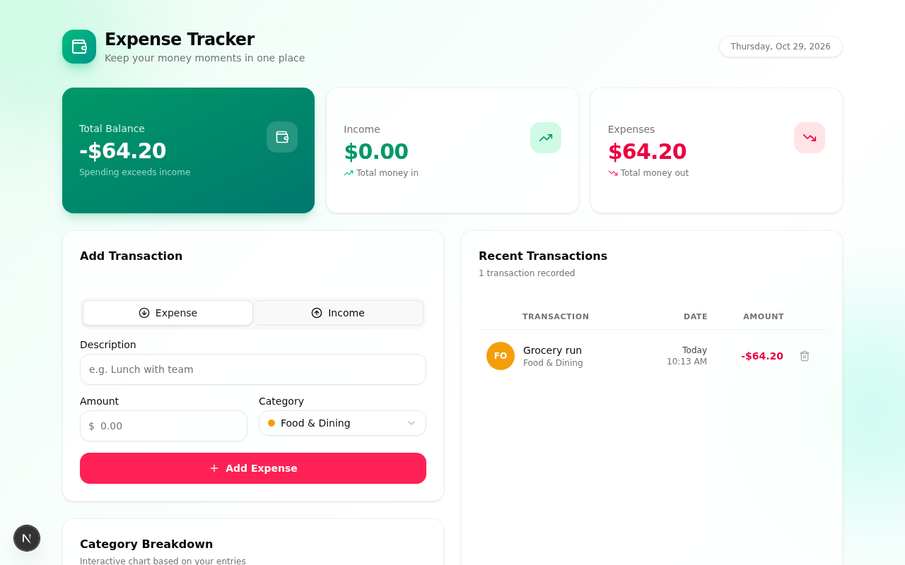
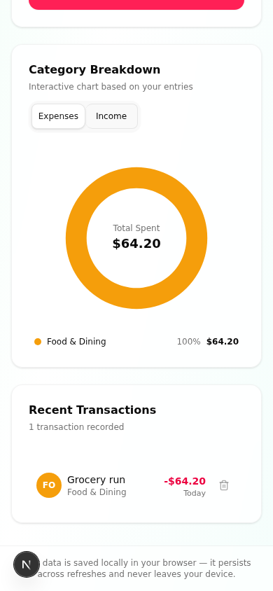

# Expense Tracker

A simple, responsive expense tracker built with Next.js 16, React 19, Tailwind CSS 4, shadcn/ui, Recharts, and framer-motion. All data is stored locally in your browser via localStorage — nothing ever leaves your device.

## Features

- **Summary dashboard** — Total Balance, Income, and Expenses cards with spring-animated count-up numbers
- **Transaction form** — description, amount, category picker, and an Expense/Income toggle with contextual categories and inline validation
- **Recent transactions list** — sorted newest-first with a dedicated date column (Today / Yesterday / full date + time), category chips, and a delete button
- **Undo delete** — accidentally removed transactions can be restored from the toast notification
- **Interactive donut chart** — expense/income breakdown by category with hover-synced slices, legend, and animated center readout
- **LocalStorage persistence** — transactions survive page refreshes; data stays in the browser
- **Fully responsive** — dedicated mobile and desktop layouts

## Screenshots

| Desktop | Mobile |
| --- | --- |
|  |  |

## Getting started

Prerequisites: Node.js 18+ (or Bun 1.1+).

```bash
git clone https://github.com/monicarajeshkannan-1192007/git_practice.git
cd git_practice
bun install        # or: npm install
bun run dev        # or: npm run dev
```

Open http://localhost:3000 in your browser.

> The expense tracker itself is 100% client-side and needs no configuration. The repository also includes a Prisma/SQLite scaffold for optional server-side persistence — to use it, create a `.env` file with `DATABASE_URL="file:./db/custom.db"`, then run `npm run db:push`.

## Tech stack

| Layer | Tools |
| --- | --- |
| Framework | Next.js 16 (App Router), React 19, TypeScript |
| Styling | Tailwind CSS 4, shadcn/ui (Radix primitives) |
| Charts | Recharts |
| Animation | framer-motion |
| Dates | date-fns |
| Icons | lucide-react |
| Persistence | browser localStorage |
| Optional DB | Prisma + SQLite (scaffold) |

## Project structure

```
src/
├── app/                     # App Router pages & layout
├── components/
│   ├── expense/             # Feature components
│   │   ├── summary-cards.tsx       # Balance / Income / Expenses cards
│   │   ├── transaction-form.tsx    # Add-transaction form
│   │   ├── transaction-list.tsx    # List with date column & delete/undo
│   │   ├── category-pie-chart.tsx  # Interactive donut chart
│   │   └── animated-number.tsx     # Spring count-up numbers
│   └── ui/                  # shadcn/ui primitives
├── hooks/
│   └── use-transactions.ts  # State + localStorage persistence
└── lib/
    └── expense.ts           # Types, categories, currency helpers
```

## Privacy

Transactions are saved in your browser's localStorage under the key `expense-tracker:transactions`. There is no server, no account, and no tracking.
